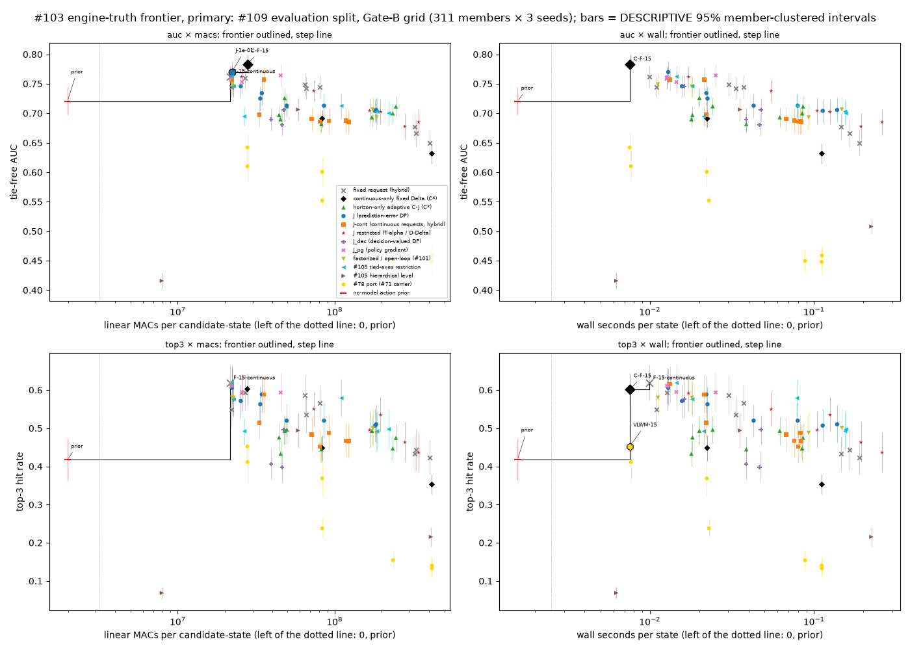

# Issue #103: engine-truth compute–quality frontier of the request policies

Parent: #108. Gate B passed. The binding #85 rules apply, and the #111 deterministic, tie-free scoring contract is adopted. Earlier records and dispositions (#74, #96, #101, #105, #108 Gate B, #114) are read-only inputs. The ICLR submission is not edited. The correction goes to the MANUSCRIPT ticket **#122**.

| Deliverable | Location |
| --- | --- |
| Runner | `scripts/run_engine_truth_frontier.py` |
| Tests | `tests/test_issue_103_engine_truth_frontier.py` (Pareto set, batched Pareto against brute force, cluster means, bootstrap frontier shares, frozen vs post-hoc wall axis, confirmatory tables equal the first publication; 8 tests) |
| Artifacts | `.local-artifacts/issue-103-engine-truth-frontier-v1/`. Committed: `findings.md`, `frontier-table.csv`, `frontier-primary.png`, `frontier-secondary.png`, `frontier-inventories.png`, `compute.json`, `summary.json`, `manifest.json`, `plan.json`, `smoke.json`, `ledger/`, `superseded/`. Kept local: `records/` (274 new records, 79 MB). |
| Freeze | `74d6006e`, 2026-10-14T15:00:15Z. The smoke passed before any new scoring. |
| Post-freeze amendment | Three-seed re-timing of the wall axis. It is post-hoc DESCRIPTIVE only; the confirmatory wall axis is the frozen seed-20260908 pass (§ Amendment). |
| Validation | `python -u -m scripts.run_engine_truth_frontier --validate` exits 0. All 8 published files, figures included, are regenerated and byte-compared. J and C-J (λ 1e-4) are re-scored on every secondary cell of seed 20260908, with exactly equal rows and schedules. |
| MANUSCRIPT ticket | #122 |

## Result

### The ICLR sentence: `not_supported_by_this_experiment`

The sentence under test is "matches a horizon-only adaptive baseline at a third of its compute". It rests on #74:
- hybrid adaptive used 118.7M and continuous adaptive 356.0M MACs per candidate-state;
- quality was regret on the count-cost proxy, which #82 and #85 construct-invalidated.

On engine verdicts, with the transferred ICLR operating recipe (λ = 1e-4 for both policies):

| Primary grid (311 levels × 3 seeds) | J | C-J (horizon-only adaptive, C*) | Ratio / difference |
| --- | --- | --- | --- |
| Linear MACs per candidate-state | 184.0M | 234.7M | **0.784** (the rule needs ≤ 0.40) |
| Wall seconds per state (frozen timing pass, seed 20260908) | 0.242 | 0.014 | 16.74 |
| Wall seconds per state (post-hoc three-seed re-timing, DESCRIPTIVE) | 0.138 | 0.085 | 1.63 |
| Tie-free AUC | 0.706 [0.685, 0.727] | 0.700 [0.683, 0.717] | J − C-J **+0.006 [0.000, 0.012]** |

**"Matches" holds; "at a third of its compute" does not.**
- J is non-inferior at δ: the lower bound is above −0.02. The positive difference is below δ, so it is not a win.
- J costs 0.78× C-J's MACs, not a third. C-J is also faster per state in wall time, on the frozen timing pass (ratio 16.74, seed 20260908 only) and on the post-hoc three-seed re-timing (1.63). The seed-20260908 C-J policy makes far fewer transition calls than the pooled one, so the frozen wall ratio describes that seed. The token uses MACs and is unaffected.
- The declared secondary set agrees: #93 grid MAC ratio 0.786, J − C-J +0.022 [−0.004, 0.052].

**Both operating points are off the frontier.**
- C-F-15 dominates both. It is the fixed (15, continuous) request on C*: 27.8M MACs, AUC 0.783. C-F-15 − J = +0.078 [0.066, 0.090] and C-F-15 − C-J = +0.083 [0.073, 0.094], both `supported`.
- The no-model action prior also dominates both (0 model MACs, 0.720).

**Descriptively, at other λ:**
- J at λ = 1e-1 (22.1M, 0.770) dominates every C-J λ point.
- J at λ = 3e-4 meets the "a third" condition (ratio 0.36) and is non-inferior (+0.013 [0.004, 0.022]).
- Neither is the ICLR operating point. Every adaptive point stays below or beside fixed coarse requests.

MANUSCRIPT ticket **#122** asks for the sentence to be replaced in the camera-ready or the next version.

### Frontier (AUC × MACs per candidate-state)

| Set / inventory | Pareto set (bootstrap frontier share) |
| --- | --- |
| **Primary grid** | no-model prior (0 MACs, 0.720; share 1.00), F-15-continuous (21.5M, 0.762; 1.00), J λ = 1e-1 (22.1M, 0.770; 1.00), C-F-15 (27.8M, 0.783; 1.00) |
| Primary offset | prior (0.500, all tied), H-15-macro, F-15-continuous, J λ = 1e-3, J λ = 3e-3, F-5-micro |
| Primary angle | prior (0.812), J λ = 3e-3, J λ = 1e-3, F-5-micro |
| Primary power | prior (0.500, all tied), F-15-continuous, F-15-macro, J λ = 1e-1, J_pg λ = 1e-4 |
| Secondary #93 grid | prior (1.00), F-15-continuous (0.74), J λ = 1e-1 (0.75), C-F-15 (0.69) |
| Secondary offset / angle / power | See `findings.md`. Each frontier contains F-15-continuous and the prior, plus 1 to 4 adaptive or fixed points. |

Other axis pairs on the primary grid:
- AUC × wall (frozen seed-20260908 timing): {prior, C-F-15}. The post-hoc three-seed re-timing gives the same set.
- Top-3 × MACs: {prior, F-15-continuous}.
- Top-3 × wall (frozen seed-20260908 timing): {prior, F-15-continuous, C-F-15}. The post-hoc three-seed re-timing adds VLWM-15 (DESCRIPTIVE).

How to read the frontier:
- **On grid, the frontier is coarse-horizon and nearly fixed.** J λ = 1e-1 requests Δ = 15 at every step: (15, continuous) 68 % and (15, macro) 32 % (#114 schedule diagnostics). Its schedules differ between candidates in 151 of 933 cells.
- The paired differences among the three model points on the grid frontier are mostly below δ:
  - J λ = 1e-1 − F-15-continuous = +0.008 [0.005, 0.010], `not_supported_by_this_experiment`.
  - C-F-15 − J λ = 1e-1 = +0.013 [0.007, 0.020], `readiness_or_precision_insufficient`.
  - C-F-15 − F-15-continuous = +0.021 [0.013, 0.030], `supported`.
  - Against the prior: J λ = 1e-1 is +0.050 [0.023, 0.076] and C-F-15 is +0.063 [0.039, 0.087], both `supported`. Above 21M MACs, the model needed to beat the zero-compute prior by at least δ is cheap.
- **No policy that adapts its horizon at short Δ is on any grid frontier.** Every J/J-cont/C-J/T/D/M/OL point with more than 26M MACs is dominated, mostly by C-F-15 with a `supported` margin.
- **The prior is on every frontier**, because it is the only zero-compute point. On offset and power it is all-tied (AUC 0.500), because the fit split executed no offset or power actions. That frontier membership is mechanical, and the tie counts show it.
- **Offset and angle (DESCRIPTIVE) favour Δ = 5 and J at λ = 1e-3 / 3e-3.** This matches #101's finding that F_hindsight is F-5-micro off grid.

### One-line verdict per policy (primary grid, AUC × MACs)

Each dominated policy names its strongest dominator: the policy with the highest AUC among those with no more MACs. The paired dominator − policy difference is member-clustered, with its δ token. The share is the fraction of bootstrap draws in which the policy is on the frontier. A `not_supported_by_this_experiment` or `readiness_or_precision_insufficient` token means the point dominance has no AUC margin of at least δ behind it.

| Policy | AUC | Top-3 | MACs | Wall s/state (frozen seed 20260908) | Tied pairs | Share | Verdict |
| --- | --- | --- | --- | --- | --- | --- | --- |
| F-1-continuous | 0.677 [0.655, 0.699] | 0.433 [0.388, 0.479] | 322.3M | 0.147 | 0/18945 | 0.00 | dominated by C-F-15 (+0.106 [+0.091, +0.122], `supported`) |
| F-1-micro | 0.650 [0.628, 0.672] | 0.422 [0.378, 0.468] | 404.0M | 0.187 | 0/18945 | 0.00 | dominated by C-F-15 (+0.133 [+0.115, +0.151], `supported`) |
| F-1-macro | 0.666 [0.643, 0.689] | 0.444 [0.389, 0.498] | 329.6M | 0.165 | 0/18945 | 0.00 | dominated by C-F-15 (+0.117 [+0.103, +0.133], `supported`) |
| F-5-continuous | 0.749 [0.729, 0.768] | 0.586 [0.537, 0.637] | 64.5M | 0.030 | 0/18945 | 0.00 | dominated by C-F-15 (+0.035 [+0.026, +0.044], `supported`) |
| F-5-micro | 0.745 [0.725, 0.764] | 0.566 [0.520, 0.614] | 80.8M | 0.037 | 0/18945 | 0.00 | dominated by C-F-15 (+0.039 [+0.030, +0.048], `supported`) |
| F-5-macro | 0.743 [0.724, 0.762] | 0.535 [0.488, 0.584] | 65.9M | 0.033 | 0/18945 | 0.00 | dominated by C-F-15 (+0.041 [+0.034, +0.048], `supported`) |
| F-15-continuous | 0.762 [0.743, 0.781] | 0.618 [0.572, 0.667] | 21.5M | 0.010 | 0/18945 | 1.00 | **on the frontier** |
| F-15-micro | 0.760 [0.741, 0.779] | 0.593 [0.547, 0.641] | 26.9M | 0.013 | 0/18945 | 0.00 | dominated by J-1e-01 (+0.010 [+0.007, +0.013], `not_supported_by_this_experiment`) |
| F-15-macro (Gate-B unit) | 0.744 [0.727, 0.762] | 0.549 [0.505, 0.594] | 22.0M | 0.011 | 0/18945 | 0.00 | dominated by F-15-continuous (+0.018 [+0.012, +0.024], `readiness_or_precision_insufficient`) |
| C-F-1 | 0.632 [0.614, 0.649] | 0.353 [0.328, 0.378] | 416.7M | 0.113 | 0/18945 | 0.00 | dominated by C-F-15 (+0.152 [+0.136, +0.168], `supported`) |
| C-F-5 | 0.691 [0.676, 0.706] | 0.448 [0.415, 0.481] | 83.3M | 0.023 | 0/18945 | 0.00 | dominated by C-F-15 (+0.092 [+0.084, +0.101], `supported`) |
| C-F-15 (C*) | 0.783 [0.768, 0.799] | 0.602 [0.562, 0.643] | 27.8M | 0.008 | 0/18945 | 1.00 | **on the frontier** |
| C-J λ 1e-5 | 0.726 [0.710, 0.742] | 0.493 [0.457, 0.531] | 48.0M | 0.015 | 0/18945 | 0.00 | dominated by C-F-15 (+0.058 [+0.049, +0.067], `supported`) |
| C-J λ 1e-4 | 0.700 [0.683, 0.717] | 0.447 [0.415, 0.480] | 234.7M | 0.014 | 0/18945 | 0.00 | dominated by C-F-15 (+0.083 [+0.073, +0.094], `supported`) |
| C-J λ 3e-4 | 0.711 [0.694, 0.729] | 0.475 [0.438, 0.512] | 245.7M | 0.014 | 0/18945 | 0.00 | dominated by C-F-15 (+0.072 [+0.061, +0.083], `supported`) |
| C-J λ 1e-3 | 0.693 [0.677, 0.710] | 0.493 [0.456, 0.531] | 172.9M | 0.014 | 0/18945 | 0.00 | dominated by C-F-15 (+0.090 [+0.079, +0.102], `supported`) |
| C-J λ 3e-3 | 0.682 [0.667, 0.696] | 0.445 [0.413, 0.478] | 82.2M | 0.014 | 0/18945 | 0.00 | dominated by C-F-15 (+0.102 [+0.092, +0.111], `supported`) |
| C-J λ 1e-2 | 0.712 [0.698, 0.726] | 0.496 [0.461, 0.532] | 49.6M | 0.011 | 0/18945 | 0.00 | dominated by C-F-15 (+0.071 [+0.063, +0.080], `supported`) |
| C-J λ 3e-2 | 0.690 [0.677, 0.703] | 0.433 [0.400, 0.467] | 45.2M | 0.011 | 0/18945 | 0.00 | dominated by C-F-15 (+0.094 [+0.084, +0.103], `supported`) |
| C-J λ 1e-1 | 0.697 [0.683, 0.711] | 0.476 [0.440, 0.511] | 44.2M | 0.011 | 0/18945 | 0.00 | dominated by C-F-15 (+0.086 [+0.077, +0.095], `supported`) |
| J λ 1e-5 | 0.704 [0.684, 0.724] | 0.507 [0.464, 0.551] | 181.2M | 0.183 | 0/18945 | 0.00 | dominated by C-F-15 (+0.079 [+0.070, +0.089], `supported`) |
| J λ 1e-4 (ICLR) | 0.706 [0.685, 0.727] | 0.510 [0.462, 0.561] | 184.0M | 0.242 | 0/18945 | 0.00 | dominated by C-F-15 (+0.078 [+0.066, +0.090], `supported`) |
| J λ 3e-4 | 0.713 [0.692, 0.734] | 0.520 [0.474, 0.568] | 85.5M | 0.028 | 0/18945 | 0.00 | dominated by C-F-15 (+0.070 [+0.059, +0.082], `supported`) |
| J λ 1e-3 | 0.734 [0.714, 0.755] | 0.588 [0.541, 0.638] | 34.4M | 0.021 | 0/18945 | 0.00 | dominated by C-F-15 (+0.049 [+0.039, +0.060], `supported`) |
| J λ 3e-3 | 0.725 [0.705, 0.745] | 0.563 [0.519, 0.608] | 33.6M | 0.021 | 0/18945 | 0.00 | dominated by C-F-15 (+0.058 [+0.047, +0.069], `supported`) |
| J λ 1e-2 | 0.713 [0.693, 0.733] | 0.520 [0.478, 0.563] | 49.5M | 0.035 | 0/18945 | 0.00 | dominated by C-F-15 (+0.070 [+0.058, +0.083], `supported`) |
| J λ 3e-2 | 0.746 [0.727, 0.764] | 0.571 [0.527, 0.615] | 25.2M | 0.017 | 0/18945 | 0.00 | dominated by J-1e-01 (+0.024 [+0.020, +0.028], `supported`) |
| J λ 1e-1 | 0.770 [0.751, 0.788] | 0.606 [0.559, 0.654] | 22.1M | 0.013 | 0/18945 | 1.00 | **on the frontier** |
| J-cont λ 1e-5 | 0.688 [0.666, 0.709] | 0.467 [0.423, 0.513] | 118.1M | 0.033 | 0/18945 | 0.00 | dominated by C-F-15 (+0.096 [+0.084, +0.108], `supported`) |
| J-cont λ 1e-4 | 0.686 [0.665, 0.706] | 0.466 [0.422, 0.512] | 122.7M | 0.048 | 0/18945 | 0.00 | dominated by C-F-15 (+0.098 [+0.085, +0.111], `supported`) |
| J-cont λ 3e-4 | 0.686 [0.665, 0.707] | 0.452 [0.409, 0.496] | 80.3M | 0.053 | 0/18945 | 0.00 | dominated by C-F-15 (+0.098 [+0.085, +0.110], `supported`) |
| J-cont λ 1e-3 | 0.687 [0.666, 0.709] | 0.488 [0.442, 0.535] | 91.9M | 0.038 | 0/18945 | 0.00 | dominated by C-F-15 (+0.096 [+0.083, +0.110], `supported`) |
| J-cont λ 3e-3 | 0.691 [0.670, 0.711] | 0.483 [0.439, 0.528] | 71.5M | 0.021 | 0/18945 | 0.00 | dominated by C-F-15 (+0.093 [+0.081, +0.105], `supported`) |
| J-cont λ 1e-2 | 0.698 [0.676, 0.719] | 0.514 [0.471, 0.561] | 33.1M | 0.029 | 0/18945 | 0.00 | dominated by C-F-15 (+0.086 [+0.074, +0.098], `supported`) |
| J-cont λ 3e-2 | 0.757 [0.738, 0.776] | 0.588 [0.540, 0.639] | 35.3M | 0.037 | 0/18945 | 0.00 | dominated by C-F-15 (+0.026 [+0.018, +0.034], `supported`) |
| J-cont λ 1e-1 | 0.757 [0.738, 0.776] | 0.615 [0.568, 0.663] | 22.1M | 0.013 | 0/18945 | 0.00 | dominated by J-1e-01 (+0.013 [+0.010, +0.016], `not_supported_by_this_experiment`) |
| T-continuous | 0.702 [0.681, 0.724] | 0.535 [0.491, 0.581] | 196.1M | 0.139 | 0/18945 | 0.00 | dominated by C-F-15 (+0.081 [+0.068, +0.094], `supported`) |
| T-micro | 0.704 [0.683, 0.726] | 0.495 [0.448, 0.543] | 167.1M | 0.251 | 0/18945 | 0.00 | dominated by C-F-15 (+0.079 [+0.066, +0.092], `supported`) |
| T-macro | 0.678 [0.655, 0.700] | 0.463 [0.411, 0.517] | 280.0M | 0.150 | 0/18945 | 0.00 | dominated by C-F-15 (+0.106 [+0.092, +0.120], `supported`) |
| D-1 | 0.685 [0.663, 0.707] | 0.436 [0.384, 0.490] | 343.0M | 0.303 | 0/18945 | 0.00 | dominated by C-F-15 (+0.098 [+0.084, +0.113], `supported`) |
| D-5 | 0.738 [0.719, 0.757] | 0.550 [0.505, 0.596] | 73.6M | 0.056 | 0/18945 | 0.00 | dominated by C-F-15 (+0.046 [+0.036, +0.056], `supported`) |
| D-15 | 0.762 [0.743, 0.780] | 0.592 [0.544, 0.641] | 25.5M | 0.017 | 0/18945 | 0.00 | dominated by J-1e-01 (+0.008 [+0.005, +0.011], `not_supported_by_this_experiment`) |
| J_dec λ 1e-4 | 0.681 [0.662, 0.700] | 0.398 [0.358, 0.439] | 46.3M | 0.041 | 0/18945 | 0.00 | dominated by C-F-15 (+0.103 [+0.090, +0.116], `supported`) |
| J_dec λ 1e-3 | 0.690 [0.671, 0.709] | 0.406 [0.365, 0.447] | 39.3M | 0.041 | 0/18945 | 0.00 | dominated by C-F-15 (+0.094 [+0.082, +0.106], `supported`) |
| J_dec λ 1e-2 | 0.706 [0.686, 0.726] | 0.496 [0.458, 0.534] | 47.4M | 0.072 | 0/18945 | 0.00 | dominated by C-F-15 (+0.077 [+0.067, +0.088], `supported`) |
| J_dec λ 1e-1 (#101 J_dec) | 0.746 [0.728, 0.764] | 0.576 [0.531, 0.622] | 22.7M | 0.013 | 0/18945 | 0.00 | dominated by J-1e-01 (+0.024 [+0.021, +0.027], `supported`) |
| J_pg λ 1e-4 | 0.764 [0.745, 0.783] | 0.594 [0.544, 0.644] | 45.2M | 0.037 | 0/18945 | 0.00 | dominated by C-F-15 (+0.019 [+0.012, +0.026], `readiness_or_precision_insufficient`) |
| J_pg λ 1e-3 | 0.753 [0.734, 0.772] | 0.595 [0.549, 0.642] | 25.7M | 0.015 | 0/18945 | 0.00 | dominated by J-1e-01 (+0.017 [+0.013, +0.021], `readiness_or_precision_insufficient`) |
| J_pg λ 1e-2 | 0.761 [0.742, 0.780] | 0.611 [0.565, 0.658] | 22.1M | 0.013 | 0/18945 | 0.00 | dominated by J-1e-01 (+0.009 [+0.005, +0.012], `not_supported_by_this_experiment`) |
| J_pg λ 1e-1 (#101 J_pg) | 0.761 [0.742, 0.780] | 0.611 [0.565, 0.658] | 22.1M | 0.014 | 0/18945 | 0.00 | dominated by J-1e-01 (+0.009 [+0.005, +0.012], `not_supported_by_this_experiment`) |
| M-pe | 0.706 [0.685, 0.728] | 0.501 [0.451, 0.552] | 175.4M | 0.254 | 0/18945 | 0.00 | dominated by C-F-15 (+0.077 [+0.065, +0.090], `supported`) |
| M-dec | 0.745 [0.727, 0.763] | 0.580 [0.535, 0.626] | 22.7M | 0.015 | 0/18945 | 0.00 | dominated by J-1e-01 (+0.025 [+0.021, +0.028], `supported`) |
| OL-pe | 0.693 [0.672, 0.715] | 0.488 [0.436, 0.540] | 185.1M | 0.147 | 0/18945 | 0.00 | dominated by C-F-15 (+0.090 [+0.078, +0.103], `supported`) |
| OL-dec | 0.749 [0.731, 0.767] | 0.580 [0.536, 0.625] | 22.2M | 0.011 | 0/18945 | 0.00 | dominated by J-1e-01 (+0.021 [+0.018, +0.024], `supported`) |
| J_diag | 0.713 [0.692, 0.733] | 0.579 [0.529, 0.629] | 110.5M | 0.123 | 0/18945 | 0.00 | dominated by C-F-15 (+0.071 [+0.060, +0.082], `supported`) |
| J_monotone | 0.703 [0.682, 0.724] | 0.492 [0.443, 0.542] | 186.7M | 0.269 | 0/18945 | 0.00 | dominated by C-F-15 (+0.080 [+0.068, +0.093], `supported`) |
| J_anti | 0.700 [0.679, 0.721] | 0.497 [0.447, 0.549] | 221.3M | 0.206 | 0/18945 | 0.00 | dominated by C-F-15 (+0.083 [+0.072, +0.095], `supported`) |
| J_dec_diag | 0.695 [0.679, 0.711] | 0.492 [0.458, 0.527] | 26.6M | 0.033 | 0/18945 | 0.00 | dominated by J-1e-01 (+0.075 [+0.059, +0.091], `supported`) |
| J_dec_monotone | 0.746 [0.728, 0.764] | 0.576 [0.531, 0.622] | 22.7M | 0.015 | 0/18945 | 0.00 | dominated by J-1e-01 (+0.024 [+0.021, +0.027], `supported`) |
| J_dec_anti | 0.762 [0.743, 0.781] | 0.618 [0.572, 0.667] | 22.1M | 0.014 | 0/18945 | 0.00 | dominated by F-15-continuous (+0.000 [+0.000, +0.000], `not_supported_by_this_experiment`): identical rankings, more MACs (policy calls) |
| H-1-continuous | 0.508 [0.495, 0.520] | 0.215 [0.190, 0.241] | 410.8M | 0.224 | 0/18945 | 0.00 | dominated by C-F-15 (+0.275 [+0.256, +0.295], `supported`) |
| H-5-micro | 0.706 [0.688, 0.725] | 0.494 [0.449, 0.540] | 58.5M | 0.036 | 0/18945 | 0.00 | dominated by C-F-15 (+0.077 [+0.064, +0.089], `supported`) |
| H-15-macro | 0.416 [0.402, 0.430] | 0.069 [0.054, 0.084] | 7.9M | 0.006 | 0/18945 | 0.00 | dominated by prior (+0.304 [+0.272, +0.337], `supported`) |
| TAWM-1 | 0.459 [0.441, 0.476] | 0.133 [0.110, 0.156] | 416.7M | 0.111 | 0/18945 | 0.00 | dominated by C-F-15 (+0.325 [+0.296, +0.354], `supported`) |
| TAWM-5 | 0.601 [0.576, 0.626] | 0.369 [0.322, 0.416] | 83.3M | 0.022 | 0/18945 | 0.00 | dominated by C-F-15 (+0.183 [+0.163, +0.202], `supported`) |
| TAWM-15 | 0.610 [0.585, 0.636] | 0.412 [0.357, 0.466] | 27.8M | 0.008 | 0/18945 | 0.00 | dominated by C-F-15 (+0.173 [+0.153, +0.193], `supported`) |
| VLWM-1 | 0.448 [0.426, 0.469] | 0.140 [0.116, 0.166] | 416.7M | 0.113 | 0/18945 | 0.00 | dominated by C-F-15 (+0.335 [+0.305, +0.366], `supported`) |
| VLWM-5 | 0.552 [0.542, 0.562] | 0.238 [0.211, 0.266] | 83.3M | 0.023 | 0/18945 | 0.00 | dominated by C-F-15 (+0.231 [+0.215, +0.248], `supported`) |
| VLWM-15 | 0.642 [0.619, 0.666] | 0.452 [0.401, 0.505] | 27.8M | 0.008 | 0/18945 | 0.00 | dominated by C-F-15 (+0.141 [+0.126, +0.156], `supported`) |
| TAWM-adaptive | 0.450 [0.430, 0.469] | 0.154 [0.130, 0.180] | 236.0M | 0.078 | 0/18945 | 0.00 | dominated by C-F-15 (+0.334 [+0.304, +0.364], `supported`) |
| No-model action prior | 0.720 [0.696, 0.744] | 0.418 [0.363, 0.473] | 0 | 0 (not timed) | 42/18945 | 1.00 | **on the frontier** |

Ties:
- On every inventory and in both sets, every model policy has zero all-tied cells and zero tied success/failure pairs. Typed failures and nonfinite endpoints are zero as well. The #111 tie-free cost removes the ties that the #74 count cost produced (196/73/61 of 200 states for continuous_adaptive).
- The prior has 42 / 18,945 tied pairs on the primary grid and 3 / 723 on the secondary grid.
- On offset and power, every prior cell is all-tied in both sets: 228/228 and 141/141 cells on the primary set. The fit split executed none of those actions.

The secondary-set verdicts (#93 grid, 14 members × 3 seeds) are in `findings.md`. The frontier set is the same four points, with shares 1.00 (prior), 0.74 (F-15-continuous), 0.75 (J λ = 1e-1) and 0.69 (C-F-15). With 14 clusters, more dominance contrasts are `readiness_or_precision_insufficient`. C-F-15 still dominates both ICLR operating points with a `supported` margin.

## Protocol

### Sets and cells

- **Primary.** The Gate-B mixed cells of the #104 sealed #109 evaluation split, with the Gate-B anchors (E99) and pig-removal engine verdicts:
  - grid 311 levels (primary); offset 76, angle 78 and power 47 (DESCRIPTIVE);
  - three seeds each.
  - The #78 ports use the #105 F77 parses of the same frames.
- **Declared secondary.** The #96 universe of #93/#94/#87 engine verdicts (`first_shot_success`), mixed member cells only:
  - #93 Arm B grid (14 members);
  - #93 Arm A offset (9);
  - #87 + #89 angle (7; #89 typed-unmeasurable states excluded);
  - #94 power (8).
  - E99 anchors: the retained #112 v1 parses of `p94.frozen_anchor`. The smoke re-parse differs by at most 5.4e-7.
  - F77 anchors for the #78 ports are parsed here (`--anchors`, 15 members).
  - DESCRIPTIVE. These N1 lineages were in the fitting data of the E99 encoder (#99, 11 of 15) and of the #78 ports. The LC predictors and all policies never saw them.
- **Cost.** #111 tie-free endpoint cost against the anchor, under `deterministic_scoring()`. No engine calls.

### Policies (70 plus the prior)

| Group | Policies | Source records |
| --- | --- | --- |
| Fixed requests (hybrid LC) | F-{1,5,15}-{continuous,micro,macro} | #101 |
| Continuous-only fixed Δ (C*) | C-F-1, C-F-5, C-F-15 | #114 (1, 5); #101 (15) |
| Horizon-only adaptive | C-J at λ ∈ {1e-5, 1e-4, 3e-4, 1e-3, 3e-3, 1e-2, 3e-2, 1e-1} | #114 |
| J (prediction-error DP) | the same 8 λ | #101 (1e-5, 1e-4, 1e-3, 1e-2), #114 (the rest) |
| J-cont; J restricted | 8 λ; T-{continuous,micro,macro}, D-{1,5,15} | #114 |
| Decision-aware | J_dec (dec, 4 λ), J_pg (pg, 4 λ, a separate type) | #101 |
| Factorized / open-loop | M-pe, M-dec, OL-pe, OL-dec (OL primary only) | #101 |
| #105 arms | J_diag / J_monotone / J_anti, J_dec_diag / J_dec_monotone / J_dec_anti, H-1-continuous / H-5-micro / H-15-macro, TAWM/VLWM-1/5/15, TAWM-adaptive | #105 |
| Prior | Gate-B no-model action prior (fit-split success frequency of the identical action) | rule |

Excluded:
- J-as-cont: a counterfactual replay that needs J to run first.
- The wrong-anchor arms: controls, not policies.
- OL on the secondary set: its streams are frozen to the primary cell order.

### Reuse

Primary numbers come from each policy's canonical retained record. Those records score exactly these cells, anchors, predictors and policies under the #111 contract. Every policy is loaded through its source runner's hash-checked loaders and scored with that runner's own scoring block. Fidelity is checked at three levels:
- **Smoke (pre-freeze):** all 70 policies re-scored on 5 primary cells (2 grid plus one per other inventory, seed 20260908). Rows, schedules, MACs and calls are equal.
- **G1 (frozen):** the seed-20260908 timing pass re-scores every primary cell for every policy and matches the retained records exactly: 35,840 cells, 0 mismatches. The post-hoc three-seed re-timing extends this check to 107,520 cells, also with 0 mismatches. That extension is reported under `posthoc_wall` and is not a guard.
- **G2:** arms recorded by two sources are identical: 43,008 cells, 0 mismatches. The pairs are the fixed arms and C-F-15 across #101/#114/#105, the four shared J λ in #101 and #114, #105 J and J_dec against #101, and the Gate-B unit and C* against #101.

`manifest.json` lists the sha256 and size of all 715 raw files the numbers come from:
- 210 retained primary records;
- 84 cross-check records;
- 70 frozen timing records (seed 20260908) and 140 post-hoc timing records (seeds 20260909/10);
- 204 secondary records;
- 5 anchor stores;
- 2 verdict sources.

### Axes, frontier, bootstrap, verdicts

- **MACs.** Linear MACs per candidate rollout to step 225, counting predictor transitions and policy calls (#96/#101 accounting; nonlinear work excluded), pooled over seeds and cells.
- **Wall.** CUDA-synchronized host seconds of one state's batched rollout, with all candidates batched. It is measured in a uniform timing pass on one process per RTX 5090, with a discarded warm-up cell. The retained wall times from the source tickets were measured under contention (#114 ran two processes per GPU). They stay in `frontier-table.csv` as `recorded_seconds_per_state` but are not used. The prior has 0 model MACs, is not timed, and is plotted at 0.
- **Pareto.** For each (set, inventory, axis pair), a point is dominated iff another has x ≤ and y ≥ it, with at least one strict. Identical points do not dominate each other.
- **Bootstrap frontier share.** Members (levels) are resampled jointly for all policies with the p94 generator (PCG64 7201, 10,000 draws). Each policy's value in a draw is the mean of its defined cluster means among the drawn members, and compute is held fixed. The tests check the Pareto set against brute force and the shares against the p94 draw matrix.
- **Verdict.** The strongest dominator, with the paired dominator − policy difference and its δ token (δ = 0.02). The verdict is stored for all four axis pairs; the AUC × MACs verdict is the headline.
- **Guards.** G1 reuse fidelity, G2 cross-source identity, G3 scoring policy, G4 frozen inputs (429 hashes), G5 chronology (freeze 15:00:15Z ≤ first new record 15:01:02Z) and G6 secondary inputs. All pass. A failed guard would have turned every token into `readiness_or_precision_insufficient`.

## Amendment and execution disclosure

- **Post-freeze timing amendment, now post-hoc DESCRIPTIVE** (2026-10-14T15:18Z, after the first publication).
  - The frozen timing pass covered seed 20260908 only. After the first publication was seen, that seed was judged unrepresentative. Each seed is a separately trained policy, and on grid at seed 20260908 J-1e-04 made 196 transition calls per candidate against 121 pooled, and C-J-1e-04 made 21 against 124.5. The frozen J / C-J wall ratio of 16.7 therefore describes seed 20260908.
  - The timing pass was then extended to all three seeds: 140 new timing records in one extra 4-GPU launch, which skipped existing records and overwrote nothing. These are **new data collected after the freeze**, so evidence did change on the wall axis. The binding rules allow no such post-freeze collection (standards review B0).
  - **Restoration (phase-A review, commit `33a81126`).** The frozen seed-20260908 pass is again the confirmatory wall axis: the wall columns, the AUC × wall and top-3 × wall frontiers, the ICLR wall ratio (16.74) and G1 (35,840 cells). `compute.json` `sets`, `iclr_sentence` and G1 equal the first publication kept in `superseded/`, and a test checks this. The three-seed wall columns, wall ratio (1.63), wall frontiers and the 107,520-cell reuse check are reported only under `posthoc_wall` in `compute.json`, in `summary.json` and in the `findings.md` amendment section. They are labelled post-hoc DESCRIPTIVE and are not a confirmatory result. The post-hoc timing compute is booked separately as `timing-posthoc` in the ledger grouping.
  - Unchanged throughout: cells, retained and secondary records, AUC and top-3, MACs, every MAC-axis frontier, share and verdict, and the ICLR token (its rule uses MACs).
  - Renderer-only fixes after the first publication: frontier labels are staggered, and edge colours are dropped for unfilled markers.
  - Post-freeze runner edits for the restoration are reporting only (the wall-source selection, the `posthoc_wall` block and labels, the timing roles in `manifest.json`). `load_plan` also checks the pinned #101/#114/#105 runners through `scripts/post_freeze_amendments.py`, which accepts exactly their frozen or disclosed amended bytes. No record was written or rescored.
- **Scoring launches.** Two launches of `--score`, each on 4 GPUs with one process per GPU. PIDs are in `logs/score-pids.txt`. Both ran to completion, with no duplicate workers and no relaunch over live workers. During the first launch, a multi-PID `kill -0` wait loop returned early. A check showed that worker 0 was still alive, so it was waited on and nothing was relaunched.
- **Known before the freeze.** Every primary AUC, MAC and recorded wall value, and the #74 table. No Gate-B-predictor policy output existed on the secondary set, and the frontier, shares, verdicts and ICLR token had not been computed.
- **Hardware.** RTX 5090 instead of the #85 RTX 3090. Wall seconds are specific to this hardware.

## Decisions under delegation (posted on #103)

1. The primary set is the Gate-B cells. The secondary set is the #96 universe (#93/#94/#87), DESCRIPTIVE.
2. The policy list and exclusions are as above. J_pg is a separate type. OL is primary only.
3. Reuse uses canonical source records, checked by G1/G2. Only the secondary set and the timing pass are new scoring.
4. Wall comes from the uniform timing pass. The contended retained times are reported but not used.
5. The frontier, the joint member-clustered bootstrap share and the strongest-dominator verdict follow the δ rule.
6. ICLR-sentence rule: J against C-J at λ = 1e-4. "A third" means a MAC ratio ≤ 0.40. "Matches" means non-inferiority at δ.
7. The wall-axis amendment is described above.
8. The compute cap was 6 GPU-h and 12 h of process wall time.

## Compute

| Phase | GPU-allocation s (= process wall s) |
| --- | --- |
| Smoke | 38 |
| Secondary F77 anchors | 1 |
| Secondary scoring (204 records) | 509 |
| Timing pass (210 records, 3 seeds; 70 frozen and 140 amended) | 6,787 |
| **Experiment ledger total** | **7,334 (2.04 GPU-h)** |
| Publication runs (3) and validation (1), outside the ledger | about 150 |

- Elapsed: about 15 minutes for the frozen launch and 21 minutes for the amended timing launch, on 4 GPUs. Engine time is 0 s.
- The retained scoring seconds of the reused records are not re-charged: #101 2,283 s, #114 13,383 s, #105 2,966 s, Gate B 49 s.
