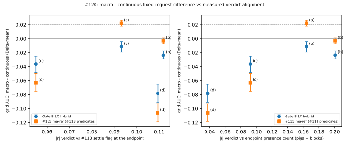

# Issue #120: endpoint-cost alignment ablation

Parent: #108. Companion to #115. The binding shared rules of #85 apply, and #120 adopts the #111 scoring contract. Gate B (#108), #101, #104, #109, #113 and #115 records are read-only inputs. Nothing here edits the ICLR 2026 submission.

| | |
| --- | --- |
| Runner | `scripts/run_cost_alignment.py` |
| Verdict module | `world_model/data/cost_verdicts.py` (light; process-pool workers import only json/gzip/math and the #113 label module) |
| Artifacts | `.local-artifacts/issue-120-cost-alignment-v1/` (`plan.json`, `smoke.json`, `verdicts.json`, `findings.md`, `summary.json`, `compute.json`, `alignment.svg`, `records-manifest.json`; local only: `records/`, `carriers/`, `data/branches-evaluation.json`, `fit/branches-fit.json`, `ledger/`, `logs/`) |
| Freeze | Plan frozen 2026-10-18T01:13:30Z (commit ced60d7f), after a passed smoke and before any evaluation verdict under (b)–(d) and any score. Evaluation verdicts were derived once at 01:17:55Z (commit c71e1566, `verdicts.json`), before the first score at 01:18:09Z. The runner is unchanged since the freeze. |
| Validation | `python -u -m scripts.run_cost_alignment --validate` exits 0 (146 s). `pytest tests/test_issue_120_cost_alignment.py` passes (12 tests). |

All intervals are percentile bootstraps clustered by level (member), with 10 000 draws (PCG64 7201), DESCRIPTIVE. The margin is δ = 0.02. Engine seconds and training are both zero.

## Result: disposition `not_supported_by_this_experiment`

The claim under test is: **"The macro ranking advantage persists under a verdict not aligned with the macro predicates."** The verdict on it is `not_supported_by_this_experiment`.

On the Gate-B LC hybrid there is no macro advantage under the control cost, so there is nothing to persist:
- Under (a), macro − continuous at matched Δ is −0.012 [−0.019, −0.004], with an upper bound below δ.
- The least-aligned eligible cost is (c), with |r| = 0.055 against the settle flag. Under (c) the difference is −0.036 [−0.048, −0.025].
- Both sensitivity rules (relative, combined) pick (c) as well and give the same token.

The pre-declared #113-coordination arm has a macro advantage under the control:
- `ma-ref` fixed requests under (a) give **+0.022 [+0.018, +0.026], `supported`**. On the predictor whose macro head reads the #113 predicates, macro beats continuous under the pig-removal cost.
- Under every alternative verdict, the same predictor's difference is ≤ 0: (b) −0.003, (c) −0.063, (d) −0.106.
- This is descriptive: the frozen disposition is defined on the Gate-B predictor. Applied to `ma-ref`, the same rule (control `supported`, c* = (c) with upper bound −0.050 < δ) would read `not_supported_by_this_experiment`. In the #113-predicate predictor, the macro advantage does not survive the least-aligned verdict.

### Frozen costs, verdicts and mixed-verdict cells (Acceptance 1)

A verdict of `True` marks the cost's decision goal. A lower model cost means that goal is predicted. Every model cost comes from one rollout per candidate.

| cost | engine verdict (native traces, #104 campaign) | model readout (same rollout) |
| --- | --- | --- |
| (a) current | pig removed (campaign `pig_removed`, #85 channel) | #111 tie-free primary at frame 225 |
| (b) structure | ≥ 1 block entity destroyed during the shot | Σ block presence − 0.1 Σ block displacement at frame 225 |
| (c) motion magnitude | summed displacement of the dynamic blocks and the pig, frame 0 to their last present step, ≥ 0.5 world units | − summed block and pig displacement at frame 225 |
| (d) early contact | engine `collision` between the launched bird and a block or the pig by frame 150 | − summed block and pig displacement at the last visited frame ≤ 150 |

Mixed-verdict cells (levels) per inventory. The guard (Work 4) gives `readiness_or_precision_insufficient` to any cost with fewer than 42 mixed grid cells.

| cost | eval prevalence | grid | offset | angle | power | guard | fit prevalence | fit grid | fit angle |
| --- | --- | --- | --- | --- | --- | --- | --- | --- | --- |
| (a) | 0.056 | 311 | 76 | 78 | 47 | pass | 0.060 | 366 | 314 |
| (b) | 0.168 | 280 | 83 | 85 | 90 | pass | 0.181 | 355 | 337 |
| (c) | 0.214 | 374 | 103 | 109 | 103 | pass | 0.225 | 447 | 427 |
| (d) | 0.286 | 389 | 113 | 117 | 105 | pass | 0.286 | 464 | 454 |

The (a) cells are exactly the Gate-B cells. Evaluation: 11 680 branches over 400 levels. Fit: 13 919 branches, read only for priors and prevalence.

### Alignment (Acceptance 2; Work 2)

Each entry is a pooled Pearson r (phi for binary pairs) over every evaluation branch, followed by the within-level r after demeaning by level. The alignment of a cost is |r| with the #113 settle flag at the trace's last frame. That flag is settle_1 from `observable_macro.shot_labels` on the stored #113 summaries; its prevalence is 0.228.

| cost | settle flag at endpoint | presence count (pigs + blocks) | present pigs | present blocks | verdict (a) |
| --- | --- | --- | --- | --- | --- |
| (a) | +0.093 [+0.070, +0.117] (+0.099) | −0.164 [−0.181, −0.148] (−0.439) | −1.000 | +0.029 [+0.015, +0.044] (+0.081) | +1.000 |
| (b) | −0.112 [−0.134, −0.089] (−0.118) | −0.201 [−0.246, −0.159] (−0.814) | +0.079 [+0.068, +0.090] (+0.083) | −0.219 [−0.265, −0.176] (−0.950) | −0.079 [−0.090, −0.068] (−0.083) |
| (c) | −0.055 [−0.079, −0.031] (−0.049) | −0.092 [−0.129, −0.057] (−0.483) | −0.439 [−0.465, −0.414] (−0.464) | −0.007 [−0.045, +0.029] (−0.272) | +0.439 [+0.414, +0.465] (+0.464) |
| (d) | −0.109 [−0.134, −0.084] (−0.124) | −0.038 [−0.077, −0.001] (−0.523) | −0.383 [−0.403, −0.363] (−0.407) | +0.037 [−0.003, +0.074] (−0.349) | +0.383 [+0.363, +0.403] (+0.407) |

Reading:
- **The settle flag at the endpoint is weakly coupled to every verdict, including the control.** |r| is between 0.055 and 0.112. The premise that "the scene has settled" and "which objects are present" are coupled by construction appears here only as a small correlation. Pig removal correlates +0.093 with settling.
- **By the primary measure, the alternative costs are not less aligned than the control.**
  - (b) (0.112) and (d) (0.109) are more aligned with the settle flag than (a) (0.093).
  - Only (c) is below both the control and the pre-declared 0.1 bound.
- **The presence-count channel gives a different order.** (b) is the most aligned (−0.201; −0.95 within level with present blocks, by construction) and (d) the least (−0.038).

### Primary: macro − continuous at matched Δ (Acceptance 2; Work 3)

The predictor is the Gate-B LC hybrid on grid. The estimate is the mean over Δ ∈ {1, 5, 15} of AUC(F-Δ-macro) − AUC(F-Δ-continuous), paired per (level, seed). Each cost has 3 seeds × its mixed grid cells.

| cost | alignment | Δ-mean | Δ 1 | Δ 5 | Δ 15 | token |
| --- | --- | --- | --- | --- | --- | --- |
| (a) | 0.093 | **−0.012 [−0.019, −0.004]** | −0.011 [−0.022, −0.001] | −0.006 [−0.014, +0.002] | −0.018 [−0.024, −0.012] | not_supported_by_this_experiment |
| (b) | 0.112 | −0.024 [−0.029, −0.018] | −0.092 [−0.110, −0.075] | +0.014 [+0.007, +0.021] | +0.008 [+0.004, +0.011] | not_supported_by_this_experiment |
| (c) | 0.055 | −0.036 [−0.048, −0.025] | −0.040 [−0.053, −0.026] | −0.040 [−0.053, −0.028] | −0.030 [−0.044, −0.015] | not_supported_by_this_experiment |
| (d) | 0.109 | −0.078 [−0.091, −0.065] | −0.097 [−0.110, −0.082] | −0.063 [−0.076, −0.050] | −0.076 [−0.093, −0.058] | not_supported_by_this_experiment |

The #113-coordination arm, `ma-ref` (#115), is the same contrast. It is pre-declared under (a) and descriptive under (b)–(d):

| cost | Δ-mean | Δ 1 | Δ 5 | Δ 15 |
| --- | --- | --- | --- | --- |
| (a) | **+0.022 [+0.018, +0.026] `supported`** | +0.015 [+0.011, +0.018] | +0.047 [+0.039, +0.055] | +0.004 [+0.000, +0.008] |
| (b) | −0.003 [−0.007, +0.001] | +0.006 [+0.005, +0.008] | +0.002 [−0.006, +0.010] | −0.017 [−0.025, −0.010] |
| (c) | −0.063 [−0.076, −0.050] | −0.055 [−0.069, −0.042] | −0.054 [−0.067, −0.041] | −0.080 [−0.096, −0.063] |
| (d) | −0.106 [−0.118, −0.094] | −0.092 [−0.105, −0.078] | −0.107 [−0.121, −0.092] | −0.120 [−0.134, −0.105] |

`alignment.svg` plots the Δ-mean difference against the measured alignment. The left panel uses the settle flag and the right panel the presence count.
- **Left panel.** Against the settle flag, the four costs show no ordering.
- **Right panel.** Against the presence count, both predictors' differences rank the costs nearly in alignment order. The two most presence-aligned costs, (b) and (a), have the largest differences, then (c), then (d). This is four points per predictor and is reported as a pattern, not tested.

### Ranking under each cost (Work 3, grid; other inventories in `findings.md`)

Pooled AUC on each cost's mixed grid cells. Every arm uses the same rollouts under every cost.

| arm | (a) | (b) | (c) | (d) |
| --- | --- | --- | --- | --- |
| F-1-continuous / F-1-macro | 0.677 / 0.666 | 0.424 / 0.332 | 0.546 / 0.507 | 0.613 / 0.517 |
| F-5-continuous / F-5-macro | 0.749 / 0.743 | 0.334 / 0.348 | 0.529 / 0.489 | 0.545 / 0.482 |
| F-15-continuous / F-15-macro | 0.762 / 0.744 | 0.338 / 0.345 | 0.485 / 0.455 | 0.504 / 0.428 |
| J (#101 `J-pe-1e-04`) | 0.706 | 0.351 | 0.467 | 0.399 |
| J_dec (#101 `J-dec-1e-01`) | 0.746 | 0.341 | 0.474 | 0.463 |
| no-model action prior | 0.720 | 0.775 | 0.636 | 0.740 |
| best fixed request (macro rank of 9) | F-15-continuous (5) | F-1-micro (3) | F-1-continuous (4) | F-1-continuous (4) |
| wrong-anchor F-15-macro: right − wrong | +0.132 [+0.122, +0.143] `supported` | −0.015 [−0.025, −0.005] | −0.010 [−0.021, −0.000] | +0.001 [−0.009, +0.011] |

The `ma-ref` rows are in `findings.md`. Its best fixed request under (a) is F-15-micro, with F-15-macro second.

Reading:
- **Under (a), the records replicate exactly.** Every row equals the published Gate-B, #101 and #115 rows bit for bit (G5, 349 212 rows). The (a) column therefore restates known numbers: F-15-continuous 0.762, F-15-macro 0.744, prior 0.720, wrong-anchor +0.132.
- **The frozen readouts of (b)–(d) do not rank their verdicts.**
  - Every model arm is at or below chance under (b) (AUC 0.33–0.45) and near chance under (c) and (d) (0.40–0.66).
  - The no-model prior ranks every alternative verdict well (0.64–0.78).
  - The wrong-anchor control shows no anchor dependence under (b)–(d): right − wrong ≤ +0.001.
  - The rollouts therefore carry level-specific information about pig removal, but the frozen block and displacement readouts of the same rollouts do not convert it into rankings of the alternative verdicts.
  - The macro − continuous differences under (b)–(d) are differences between rankers that do not read the verdict. They measure how each request's rollout moves the read quantities, not a decision advantage.
- **For the Gate-B predictor, the conclusion does not depend on (b)–(d).** It has no macro advantage under the control (a), and under every alternative cost the difference is also below δ.
- **For `ma-ref`, the descriptive pattern is a supported advantage under (a) that vanishes or inverts under (b)–(d).** That direction is what the alignment hypothesis predicts. The weak readouts above qualify it: the alternative-cost AUCs it is built on sit near or below chance.

## Protocol

### Evaluation set (decision)

- **Split.** The ticket's held-out lineages 007/008/014/016 are superseded by the #104 sealed #109 evaluation split, because Gate B passed. This is the stream `issue109-evaluation`: 400 levels and 11 680 complete branches, with 0 typed failures. The fit stream (`issue109-fit`, 13 919 branches) is read only for the prior tables and the fit prevalence. `issue109-policy` and `issue110-*` are not read.
- **Cells.** Each cell is a level × inventory with its complete candidates in ordinal order (Gate-B rule). Under each cost, only that cost's mixed-verdict cells are scored.
- **Anchors.** The Gate-B anchor store, hash-bound.

### Verdicts (`cost_verdicts.py`, frozen)

- **Trace reading.** `branch_quantities(native_root)` reads one `canonical_native_trace_v1` trace:
  - the events of every chunk, from the trailing `events` array;
  - the frame-0 positions of the dynamic blocks and the pig;
  - each one's last present position, at the step before its `entity_destroyed` event or at the last step;
  - the present pigs and blocks at the last step;
  - the first bird–block/pig `collision`.
- **Verdicts.** `verdicts(quantities, pig_removed)` applies the thresholds above.
- **Why (c) is not pig displacement.** Pig displacement alone was degenerate on the fit stream: in a 400-shot exploration, 0.25 % of shots moved the pig ≥ 0.01. (c) therefore uses the summed block and pig displacement.
- **Threshold sources.**
  - The 0.5 threshold and N = 150 were set from fit-stream exploration only.
  - N = 150 is the median frame of the first bird–structure collision in a 600-shot fit exploration (149, among the shots with such a collision), rounded to a multiple of 15. Frame 150 is therefore exact for every fixed request.
- **Settle flag.** The flag at the endpoint is read from the stored #113 trace summaries:
  - evaluation: `issue-113-temporal-macro-head-v1/summaries/evaluation`;
  - fit: `issue-113-macro-predicates-v1/summaries/fit`.

  Their hashes and frame counts are recorded per branch.
- **Scans.** Both streams were scanned with 44 forked CPU workers: fit in the smoke (294 s wall), evaluation after the freeze (242 s wall).

### Rollouts and scoring

- **Rollouts.** There is one rollout per (predictor, arm, seed, level, inventory), from the Gate-B anchor to frame 225, under `deterministic_scoring()`.
  - `rollout` is `request_policy.rollout_endpoints` op for op.
  - It also keeps each row's carrier at its last visited position ≤ 150, and that position.
- **Predictors and arms.**
  - Gate-B LC hybrid (handoff seeds 20260908/09/10): nine fixed requests, J, and J_dec.
  - #115 `ma-ref` (members hash-checked against their training reports): nine fixed requests.
  - Wrong-anchor control: Gate-B F-15-macro from the 480 fit anchors over the 16 grid candidates.
  - That makes 63 records.
- **Prior.** The no-model action prior uses the Gate-B rule under each cost's fit verdicts. It is constant (AUC 0.5) on offset and power, which were never executed in the fit split.
- **Statistics.** Cell AUC is `m99.view`. Cells are (level, seed), and the bootstrap resamples levels. The token rule: `supported` iff mean ≥ δ and lower > 0; `not_supported_by_this_experiment` iff upper < δ; otherwise `readiness_or_precision_insufficient`.

### Disposition rule (frozen)

- **c\*.** c\* is the least-aligned cost in {b, c, d} that passes the mixed-cell guard and has an alignment |r| below 0.1.
- **Tokens.**
  - `supported` iff the primary token is `supported` under both (a) and c\*.
  - `not_supported_by_this_experiment` iff either is not supported.
  - `readiness_or_precision_insufficient` otherwise, or when no eligible c\* exists.
- **Sensitivity readings.**
  - Relative: alignment below the control's.
  - Combined: max(|r settle|, |r presence|) below the control's.
- **Guard failure.** A failed guard turns every token into `readiness_or_precision_insufficient`.

### Guards (all pass)

- **G1 isolation.**
- **G2 scoring policy.** Holds on all 63 records.
- **G3 chronology.** Frozen 01:13:30Z ≤ verdicts 01:17:55Z ≤ first score 01:18:09Z.
- **G4 bindings.**
  - 63 predictor hashes, against the Gate-B handoff and the #115 training reports.
  - 6 policy hashes, against the #101 records.
  - The anchor store.
- **G5 replication.** Under (a) on the Gate-B cells, 349 212 rows are compared and 0 differ from:
  - the #101 records of all eleven Gate-B arms;
  - the Gate-B unit's wrong-anchor rows;
  - the #115 `ma-ref` default F-{1,5,15}-macro records.
- **G6 verdict integrity.**
  - The event-derived #85 pig channel equals the campaign verdict on all 11 680 evaluation and 13 919 fit branches.
  - The #113 summary frame counts equal the traces' counts.
  - The module bytes are as frozen.
- **G7 nonfinite.** 0 excluded rows.

### Smoke (pre-freeze; fit stream and fit anchors only)

- **Tail parse.** The events tail parse equals the full chunk parse on 1 009 chunks of 12 fit traces.
- **Fit stream.** Derived in full: 0 pig-channel mismatches and 0 summary-frame mismatches. Prevalence, mixed cells and alignment are recorded.
- **Rollout equivalence.** On 3 fit grid cells, for all 20 (predictor, arm) pairs, `rollout` equals `request_policy.rollout_endpoints` at frame 225. For every fixed request, the early carrier equals a rollout to frame 150.
- **Request sets.** Both predictors carry the nine requests.
- **Cost check.** `cost_row` (a) equals `EndpointCosts.row`.
- **Projection.** 0.26 h elapsed on 4 GPUs.

### Validation

`--validate` does the following and exits 0:
- re-derives every table from the records and branch files;
- byte-compares `compute.json`, `summary.json`, `findings.md`, `alignment.svg` and `records-manifest.json`. The manifest holds the sha256 of all 63 records, 63 carrier files and both branch files;
- re-scores Gate-B F-15-macro and J (seed 20260908) on all 400 grid levels; every row is identical;
- re-derives 24 evaluation branches from their native traces; all are identical.

## Decisions under delegation (posted on #120)

1. **Evaluation set.** The sealed #109 evaluation split replaces lineages 007/008/014/016. The cells are the Gate-B cells.
2. **Predictors and arms.** The Gate-B LC hybrid carries the nine fixed requests, J and J_dec (J_dec descriptive), plus the prior and wrong-anchor controls.
3. **#113-coordination arm.** This is #115 `ma-ref` fixed requests under (a).
4. **Verdict definitions and thresholds.** As above. (c) uses structure displacement because pig displacement is degenerate.
5. **Model readouts.** One rollout gives four readouts. (d) is read at the last visited frame ≤ 150.
6. **Alignment.** |r| with the #113 settle flag at the trace endpoint. Presence counts and within-level r are reported beside it.
7. **Primary contrast.** The Δ-mean macro − continuous difference on grid.
8. **Guard.** 42 mixed grid cells.
9. **Disposition rule.** The absolute |r| < 0.1 rule is primary, with the relative and combined rules as sensitivity.
10. **Compute.** 4 GPUs.

## Compute and disclosures

- **Compute.** 3 541 GPU s in total, of which 3 528 is scoring: 63 records on 4 × RTX 5090, about 15 min elapsed, plus 13 s of smoke rollouts. The summed process wall is 4 167 s. The trace scans took 23 466 CPU process-s. Engine seconds: 0. The hardware is RTX 5090 instead of the #85 RTX 3090.
- **Disposition rule set after the smoke.** The rule was set after the smoke had shown the fit alignments (|r| with the settle flag: a 0.059, b 0.096, c 0.085, d 0.139). A rule relative to the control would have left no eligible cost on the fit stream, so the absolute rule was made primary and the relative and combined rules are reported beside it. This was recorded in the frozen plan's disclosure and on #120 before scoring. On the evaluation split, all three rules select (c) and give the same token.
- **Smoke evidence and the runner.** `smoke.json` was written by the runner before that rule edit. The edit touched only the disposition logic and its texts, so the smoke checks are unaffected. The frozen plan binds the runner bytes at the freeze, and those bytes are unchanged since.
- **Execution.** Each stage was launched once: smoke, freeze, derive, score with 4 workers (one per GPU), publish. Nothing was relaunched and there were no typed failures.
  - The shell's `$!` returned empty at the scoring launch. The four worker PIDs were therefore read with `pgrep` immediately after the launch and recorded (`logs/score-pids.txt`), and the wait used them.
  - Completion was confirmed from 63 records, 63 carrier files and 63 ledger entries.
- **Known before the freeze.**
  - The Gate B, #101, #115 and #96 results under cost (a).
  - The fit-stream exploration that set the thresholds.
  - The full fit-stream prevalence, mixed cells and alignments.
  - No evaluation verdict under (b)–(d) and no model output under any new cost.
- **Not tested.** The ordering of macro − continuous by the presence-count alignment is a 4-point descriptive pattern. The `ma-ref` disposition reading is descriptive; the frozen disposition is on the Gate-B predictor.
